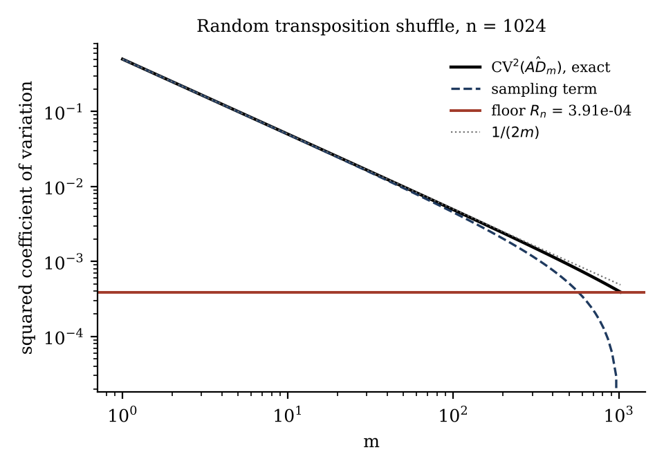
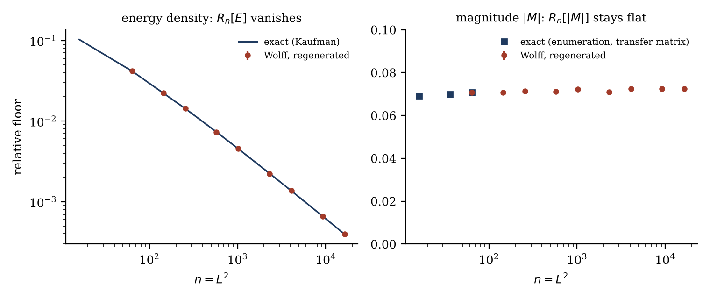

# Inference modelling

Code, data and notes for **Bayesian Inference in Partially Observed Critical Systems** (M. Singhania, arXiv:[2610.35973](https://arxiv.org/abs/2610.35973)).

The question: a system has `n` components and we see only `m` of them, chosen uniformly at random. How large must `m` be before a global statistic of the system, such as its mean displacement or magnetisation, can be inferred to a given relative tolerance? For a random transposition shuffle the answer is clean and independent of `n`. At a critical point it is not, because a second source of error does not shrink with `m`.



*Shuffle of `n = 1024` cards, exact. The coefficient of variation follows `1/(2m)` until the `m`-independent floor `R_n` takes over.*

## What is in the preprint

1. **Sample-size law (Stage 1, the RSI project).** For the random transposition shuffle and the average displacement `AD`, the mean of `m` uniformly sampled cards is unbiased and has relative standard deviation `1/√(2m)`, whatever `n` is. A conjugate Gaussian posterior gives credible intervals in closed form.
2. **The floor (Stage 2).** The law of total variance splits `Var(Ô_m)` into a sampling term that falls like `1/m` and an `m`-independent term `Var_ν(O)`. Divided by `O_∞²` this is the relative floor `R_n`. For the shuffle, `R_n = (2n²+7)/(5(n−1)²(n+1))` and `n R_n → 2/5`.
3. **Certification.** No sample size certifies a tolerance below `κ√R_n`, with `κ = z_{1−α} + z_{1−β}`. Where `R_n` stays of order one, partial observation cannot certify an equilibrium mean however many components are seen.
4. **Criticality.** At the critical point of the 2D Ising model the energy floor vanishes with `n` while the relative floor of `|M|` stays flat at about 0.07, a relative error near 27% however much is observed. In the Curie–Weiss model the floor is exactly computable. A Gaussian field with correlation length proportional to the box size also keeps a floor.
5. **Open.** The interior exponent regime `0 < a < 1`, and estimating the floor from a single realisation (Algorithm 1, a proposed estimator).

## Results reproduced here

Everything in the table below was computed by code in this repository. The critical-Ising numbers are new, seeded runs made for this repository (`data/extension/regenerated`); see [Data](#data) for how they relate to the original runs.

| Quantity | Value | Source |
|---|---|---|
| `n R_n` for the shuffle, `n → ∞` | 0.4000 (exact limit 2/5) | `rsi_shuffle.theory`, notebook 02 |
| 2D Ising, `T_c`, `R_n[|M|]` for `L = 16 … 128` | 0.071 – 0.073, slope +0.004 [0.000, 0.008] | Wolff runs |
| 2D Ising, `T_c`, `R_n[E]` slope vs `log n` | −0.863 [−0.866, −0.860]; exact (Kaufman) −0.8637 | Wolff runs, exact |
| 2D Ising, `T_c`, `χ_M` slope vs `log n` | 0.878 [0.875, 0.881]; universal value 7/8 | Wolff runs |
| Curie–Weiss `Var(M)` slope vs `log N` | −0.995 at `T = 2`, −0.495 at `T_c = 1`, +0.006 at `T = 0.7` | exact summation |



*Left: the energy floor falls on Kaufman's exact curve. Right: the floor of `|M|` is flat. Blue squares are exact small-lattice values, red dots are the Wolff runs.*

## Repository layout

```
src/rsi_shuffle/        Stage 1: shuffle, estimators, posterior, closed-form theory, variance grid
src/rsi_partial/        Stage 2: measurement instrument (cards, product chain, 2D Ising, Curie–Weiss)
tests/                  tests for rsi_shuffle and the regeneration code (rsi_partial's sit in src/rsi_partial/tests)
notebooks/              01 variance law and posterior; 02 the floor
scripts/                figures, spreadsheet export, regeneration and reproduction helpers
experiments/
  original-research/    the author's original scripts, as written
  extension/verification/   independent checks of the extension's algebra and numerics
  extension/campaign/       Wolff sampler, Ising campaign and analysis, exact Curie–Weiss
data/
  original-research/    spreadsheets behind the RSI figures, CSV exports, the variance grid
  original-research/regenerated/   seeded Stage 1 datasets
  extension/regenerated/           Wolff runs and exact Curie–Weiss moments
results/                figures and stored outputs
research/               the papers, the integrated manuscript and the working notes
docs/                   methodology, background, methods, reproducibility, history, known issues
```

`docs/inventory.md` lists where every file came from, and the files that were left out.

## Install

Python 3.11 or later.

```bash
pip install -e ".[test]"        # numpy, scipy, pandas, pyarrow, matplotlib, openpyxl, pytest
pip install -e ".[symbolic]"    # sympy, mpmath: only for two verification scripts
# or: conda env create -f environment.yml
```

A C compiler is needed only for the Wolff sampler.

## Run

```bash
make test                       # 103 tests
make check                      # fresh Monte Carlo against the stored variance grid and the exact law
make figures                    # all figures
make stage1-data                # seeded Stage 1 datasets, about five minutes
make notebooks                  # re-execute the notebooks
make ising                      # the critical-Ising campaign: hours
```

Without `make`, the commands are in the `Makefile`. Seeds, expected run times and what each command should reproduce are in `docs/reproducibility.md`.

A short tour:

```python
from rsi_shuffle import theory
theory.relative_floor(1024)            # 3.91e-04
theory.certification_cost(0.10, 1024)  # samples needed to certify 10%; about 408
```

## Data

* **Original data (Stage 1).** The spreadsheets behind the RSI figures and the variance grid, in `data/original-research`. The generating scripts used no fixed seed, so these files cannot be rebuilt bit for bit.
* **Seeded regenerations.** `data/original-research/regenerated` holds seeded versions of the calibration, the trajectory and the variance grid; `data/extension/regenerated` holds the Wolff block means, their analysis and the exact Curie–Weiss moments. They are **new runs, not the original ones**. The original raw output of the critical-Ising, Curie–Weiss, correlated-field and Algorithm 1 runs behind the extension's figures was not recovered. Each regenerated folder has a README with protocol, seeds and results; the Ising one also compares them with Table 1 of the integrated manuscript, whose numbers are the reference.
* **Stored instrument output.** `results/outputs/extension-cards-smoke` is the stored Stage 1 smoke run of the instrument for the card shuffle, reproducible by `scripts/reproduce_extension_cards_smoke.sh`. `results/outputs/extension-verification` holds the output of the independent verification scripts, including the correlated-field and Algorithm 1 checks.

## Known discrepancies

Re-running the work turned up places where stored data, the papers and independent calculations disagree. They are listed with evidence in [`docs/known-issues.md`](docs/known-issues.md) and have not been silently corrected. The main ones:

* The RSI Figure 2 data at `n = 2, 4` match a chain that swaps two *distinct* positions, whereas the paper defines the chain with independent positions. The effect disappears for `n ≥ 64`.
* The extension paper's critical `|M|` floor (0.066) and energy slope (−0.82) differ from the exact small-lattice values, the regenerated runs and the integrated manuscript (about 0.072 and −0.863).
* The stored variance grid has 77 `(n, m)` pairs, the paper's table 67 and its text 72.

## Limitations

The certificate concerns the mean of one observable and is necessary, not sufficient, for equilibrium. The Stage 1 laws are leading order in `m/n`; the exact law is in `rsi_shuffle.theory.estimator_variance`. The Ising measurements are finite-size (`L ≤ 128`) with corrections to scaling.

## Citation

See `CITATION.cff`. The preprint:

> M. Singhania. *Bayesian Inference in Partially Observed Critical Systems.* arXiv:2610.35973.

The earlier reports in `research/` are the RSI paper (*Bayesian Inference in Random Transposition Shuffles*, Research Science Initiative, India, 9 July 2026, supervised by Prof. Arvind Ayyer, Indian Institute of Science) and the extension manuscript of 2 October 2026.

## Acknowledgements

The Stage 1 work was done in the Research Science Initiative (India) under the supervision of Prof. Arvind Ayyer. Thanks to Prof. Ayyer for mentoring and for an environment that encouraged independent exploration; to Ms. Keerthana Senthil for guidance; to Tarun Prasad for reviewing the work; to Dr Amy Sillman, Max Bee Lindgren and the programme staff; and to the Centre for Excellence in Education, the Indian Institute of Science and the sponsors of RSI India. Computing costs of later work were supported by an Emergent Ventures (Mercatus Center) grant.

## Provenance and licence

[`docs/provenance.md`](docs/provenance.md) states which files are original, which were regenerated, and how an AI assistant (Claude) was used. [`docs/manuscript-revisions.md`](docs/manuscript-revisions.md) lists the changes in the revised manuscript copy. Code is released under the MIT licence (`LICENSE`); the papers, figures and data are the author's and are not covered by it unless stated otherwise.
